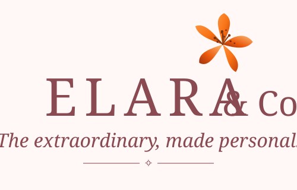

# ELARA & CO. — Little Things. Lasting Feelings.

> A luxury aesthetic gifts and handmade boutique e-commerce web application inspired by the shopping ergonomics of Myntra, curated with an editorial, romantic aesthetic.



---

## 🌸 1. Brand Identity & Color Palette

**Brand Name:** ELARA & CO.  
**Tagline:** *Little Things. Lasting Feelings.*  
**Artisan Philosophy:** "A Little More Thought, A Little More Love."  
**Brand Logo:** Featuring our signature hand-painted botanical tiger lily bloom, condensed serif typography, Italian calligraphy script, and the four-point starlight ornament.

### Color Theme Specification (Rosewater & Champagne)

| Token | Light Theme | Dark Theme | Purpose |
|---|---|---|---|
| **Primary Background** | `#FFF9F7` | `#191516` | Main backdrop |
| **Secondary Background** | `#F7E9E7` | `#252021` | Pill cards & banners |
| **Primary Accent** | `#D9A6A5` / `#8A4A52` | `#C99598` / `#E4A9AE` | Brand focus & buttons |
| **Champagne Accent** | `#E8D5B7` | `#C8AD89` | Value badges & highlights |
| **Headings & Body Text** | `#49383B` | `#F7EBE8` | Editorial typography |
| **Muted Text** | `#8C7375` | `#B9A6A5` | Meta descriptions & reviews |
| **Borders & Dividers** | `#EBDDD9` | `#403435` | Subtle outlines |
| **Cards & Surfaces** | `#FFFFFF` | `#302729` | Product & modal surfaces |

A persistent Light / Dark Theme toggle is situated in the top header and preserved via `localStorage`.

---

## 🛠️ 2. Technology Stack

- **Framework:** React 18 (TypeScript)
- **Build Tool:** Vite 5
- **Styling:** Tailwind CSS with custom brand theme tokens & Google Fonts (`Playfair Display` + `Plus Jakarta Sans`)
- **Routing:** React Router v6 (Client-side routing with deep link support)
- **Icons:** Lucide React
- **Celebration Effects:** Canvas Confetti
- **State & Storage:** Context API + LocalStorage persistence for Cart, Wishlist, Coupons, and Theme

---

## 🚀 3. Quick Start & Local Setup

### Prerequisites
- Node.js (v18 or v20+)
- npm or pnpm

### Installation

```bash
# 1. Clone repository or navigate to project directory
cd "d:\ELARA & CO"

# 2. Install dependencies
npm install

# 3. Start local development server
npm run dev
```

Visit `http://localhost:5173` in your browser.

### Production Build

```bash
# Compile TypeScript and bundle production assets
npm run build

# Preview production build locally
npm run preview
```

---

## 📂 4. Project Architecture

```
ELARA & CO/
├── index.html                     # HTML5 shell, fonts & meta tags
├── package.json                   # Dependencies & npm scripts
├── postcss.config.js              # PostCSS Tailwind plugins
├── tailwind.config.js             # Brand palette & font family extensions
├── tsconfig.json                  # TypeScript compiler options
├── vite.config.ts                 # Vite bundler configuration
├── public/
│   ├── logo.svg                   # Scalable vector brand logo
│   └── favicon.svg                # Browser tab icon
└── src/
    ├── types/
    │   └── index.ts               # Product, Review, Cart, Checkout interfaces
    ├── data/
    │   ├── products.ts            # 30+ curated real products with live Unsplash images
    │   ├── categories.ts          # 10 boutique categories
    │   └── collections.ts         # 8 price & recipient collections
    ├── context/
    │   ├── ThemeContext.tsx       # Dark/Light mode provider with LocalStorage
    │   ├── CartContext.tsx        # Bag state, quantities, coupons, gift wrap
    │   ├── WishlistContext.tsx    # Wishlist toggle, move-to-bag, LocalStorage
    │   └── ToastContext.tsx       # Non-intrusive notification toasts
    ├── utils/
    │   ├── formatters.ts          # INR currency & date formatting
    │   └── whatsapp.ts            # WhatsApp order generator & configuration
    ├── components/
    │   ├── common/
    │   │   ├── Navbar.tsx         # Responsive header, search bar, badges, mobile drawer
    │   │   ├── Footer.tsx         # Brand narrative, policies, links, copyright
    │   │   ├── Logo.tsx           # Signature logo with lily bloom & tagline
    │   │   ├── ProductCard.tsx    # Card with image hover swap, wishlist & quick view
    │   │   ├── QuickViewModal.tsx # Interactive modal preview
    │   │   ├── ImageWithFallback.tsx # Lazy loading & graceful error handling
    │   │   ├── Breadcrumb.tsx     # Navigation breadcrumb trail
    │   │   ├── ScrollToTop.tsx    # Viewport scroll reset on route changes
    │   │   └── Toast.tsx          # Floating notifications
    │   ├── home/
    │   │   ├── HeroBanner.tsx     # Editorial hero banner with CTAs
    │   │   ├── CategoryGrid.tsx   # 10 image-based category cards
    │   │   ├── TrendingCarousel.tsx # Horizontal scroll trending carousel
    │   │   ├── BestsellersGrid.tsx# Bestseller products grid
    │   │   ├── CuratedCollections.tsx # Price & recipient curated cards
    │   │   ├── BrandStorySection.tsx # "A Little More Thought, A Little More Love."
    │   │   ├── InstagramFeed.tsx  # Aesthetic photography gallery
    │   │   └── NewsletterSection.tsx # Email subscription with validation
    │   └── shop/
    │       └── FilterSidebar.tsx  # Dynamic category, price range, stock filters
    ├── pages/
    │   ├── HomePage.tsx           # Full landing experience
    │   ├── ShopPage.tsx           # Product catalog, sorting, filters & search
    │   ├── ProductDetailPage.tsx  # Image gallery, variants, pincode check, reviews
    │   ├── CartPage.tsx           # Cart management, coupons & gift packaging
    │   ├── WishlistPage.tsx       # Saved items & quick move to bag
    │   ├── CheckoutPage.tsx       # Shipping form, WhatsApp order, celebration screen
    │   ├── AboutPage.tsx          # Artisan story & ethical values
    │   ├── ContactPage.tsx        # Interactive contact form & studio information
    │   ├── FAQPage.tsx            # Accordion FAQ sections
    │   ├── ShippingPolicyPage.tsx # Delivery rates & timelines
    │   ├── ReturnPolicyPage.tsx   # 7-day hassle-free return guidelines
    │   ├── PrivacyPolicyPage.tsx  # Data handling policies
    │   ├── TermsPage.tsx          # Terms of service
    │   └── NotFoundPage.tsx       # 404 error page with redirects
    ├── App.tsx                    # Route definitions & layout wrappers
    ├── main.tsx                   # React root entry
    └── index.css                  # Tailwind styles & smooth scrollbars
```

---

## 🖼️ 5. Managing & Customizing Product Images

All product images are located in `src/data/products.ts`.

Each product contains an `images: string[]` array:
- `images[0]`: The primary card and gallery stage photograph.
- `images[1]`: The secondary photograph revealed on hover on desktop cards.
- `images[2+]`: Additional angles displayed in the product gallery carousel.

### Guidelines for Adding New Images:
1. Use high-resolution Unsplash or direct photography URLs with optimal crop query parameters:
   `https://images.unsplash.com/photo-[ID]?auto=format&fit=crop&w=800&q=80`
2. Maintain soft, warm, pastel lighting and uncluttered backgrounds that match the Rosewater & Champagne brand aesthetic.
3. The built-in `<ImageWithFallback />` component automatically handles shimmer loading and provides an aesthetic fallback SVG if any external image link ever experiences downtime.

---

## 🎁 6. Adding New Products

To add a new product, append an object to the `PRODUCTS` array in `src/data/products.ts`:

```typescript
{
  id: 'elara-hb-05',
  name: 'Rose Gold Starlight Bangle',
  slug: 'rose-gold-starlight-bangle',
  tagline: 'Delicate starry accents on hammered rose gold',
  price: 549,
  originalPrice: 699,
  discountPercentage: 21,
  rating: 4.9,
  reviewCount: 42,
  category: 'handmade-bracelets',
  categoryName: 'Handmade Bracelets',
  collections: ['under-999', 'for-her', 'handmade'],
  images: [
    'https://images.unsplash.com/photo-...?auto=format&fit=crop&w=800&q=80',
    'https://images.unsplash.com/photo-...?auto=format&fit=crop&w=800&q=80'
  ],
  description: 'Detailed artisan story and material specifications...',
  details: {
    material: '18k Rose Gold Vermeil',
    dimensions: 'Adjustable 16cm - 19cm',
    care: 'Store in airtight velvet pouch.',
    packaging: 'Rigid gift box with satin ribbon',
    handmade: true,
    dispatchTime: 'Dispatched within 24 hours',
  },
  features: [
    'Hypoallergenic lead-free finish',
    'Includes artisan care card'
  ],
  isBestseller: true,
  isTrending: true,
  inStock: true,
  stockCount: 15,
  sku: 'ELR-BRC-005',
}
```

---

## 💬 7. Configuring WhatsApp Direct Ordering

The WhatsApp integration generates pre-formatted order details (including customer name, shipping address, line items, variants, coupons, and gift messages).

To configure the boutique's WhatsApp phone number:
1. Open `src/utils/whatsapp.ts`.
2. Update the `BUSINESS_WHATSAPP_CONFIG` object:

```typescript
export const BUSINESS_WHATSAPP_CONFIG = {
  phoneNumber: '919876543210',    // Your country code + phone number without '+' or spaces
  displayNumber: '+91 98765 43210', // User-facing formatted number
  brandName: 'ELARA & CO.',
};
```

---

## 🌐 8. Deployment Instructions

### Deploy to Vercel
```bash
npm install -g vercel
vercel
```

### Deploy to Netlify
1. Connect your Git repository to Netlify.
2. Set Build Command: `npm run build`
3. Set Publish Directory: `dist`
4. Add a `_redirects` file in `public/` containing:
   `/*    /index.html   200`

---

## 📄 License
&copy; 2026 ELARA & CO. All Rights Reserved.  
*Little Things. Lasting Feelings.*

